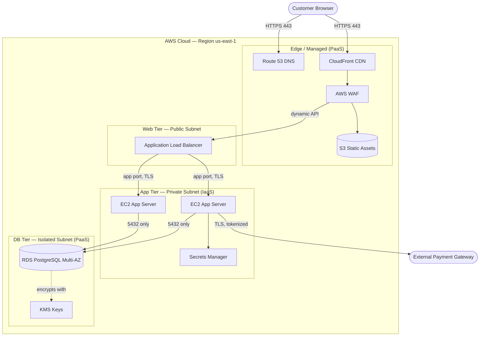

# 04 — Architecture Diagram & Trust Boundaries

The diagrams below render in any Markdown viewer that supports Mermaid (GitHub,
VS Code with a Mermaid extension, Kiro preview, etc.).

## 1. 3-Tier Architecture with Trust Boundaries

## 2. Responsibility Overlay (Who Owns What)

```mermaid
flowchart LR
    subgraph P["Cloud Provider (AWS)"]
        direction TB
        P1[Physical DCs & Hardware]
        P2[Hypervisor / Virtualization]
        P3[Managed service platform:<br/>RDS engine+OS, S3, CloudFront, IAM/KMS infra]
        P4[L3/L4 DDoS - Shield Standard]
    end

    subgraph S["Shared"]
        direction TB
        S1[TLS certs - ACM issue vs policy]
        S2[L7 DDoS / WAF]
        S3b[RDS maintenance windows]
        S4[Backups: mechanism vs retention]
        S5[Secrets Manager service vs usage]
        S6[GuardDuty findings vs triage]
    end

    subgraph C["Customer (ShopFast)"]
        direction TB
        C1[Data + classification]
        C2[App code + runtime + EC2 OS patching]
        C3[VPC design, security groups, no public App/DB]
        C4[IAM policies, MFA, least privilege]
        C5[Encryption config + KMS key policies]
        C6[Logging enablement, alerting, IR plan]
        C7[WAF rules, S3 bucket policies]
    end

    P --- S --- C
```

## 3. How to Read the Boundaries

- **Everything inside a private/isolated subnet has no public IP.** The only paths
  into the app tier are through CloudFront → WAF → ALB.
- **The dashed line to KMS** shows a control relationship (encryption), not a data
  flow.
- The **responsibility overlay** maps 1:1 to the columns in
  `03-shared-responsibility-matrix.md`: provider items = **P** rows, shared items =
  **S** rows, customer items = **C** rows.

> **Reuse tip:** If your team used Azure, swap the node labels (Front Door for
> CloudFront, App Service/VMs for EC2, Azure SQL for RDS, Key Vault for KMS/Secrets
> Manager). The trust boundaries and the responsibility split stay the same.
